# Architecture and game rules

## Boundaries

`packages/shared` defines Zod schemas, public TypeScript shapes, typed Socket.IO event maps, and original card data. `packages/engine` implements all game decisions without depending on Express or Socket.IO. `apps/server` owns transport, credentials, action validation, throttling, timer ticks, cleanup, and per-player delivery. `apps/web` displays the server state and sends requested actions.

`MemoryRoomRepository` implements the room storage interface. The current interface is synchronous because mutations are serialized by a single Node event loop. A durable backend should preserve a single serialized writer per room; simply changing map access to database access is not sufficient for distributed operation.

## State machine

```mermaid
stateDiagram-v2
    [*] --> lobby
    lobby --> submitting: Host starts; everyone ready
    submitting --> judging: Everyone submits or timer expires
    submitting --> results: No valid submissions
    judging --> results: Judge chooses, votes complete, or timer expires
    results --> submitting: Next round; replenish hands
    results --> finished: Winning condition reached
    submitting --> finished: Host ends or too few players
    judging --> finished: Host ends or too few players
    finished --> lobby: Play again
```

The host can also return any phase to the lobby. Deadlines are absolute server timestamps. A 250 ms interval advances due phases; incoming actions settle expired deadlines before being applied. Browser clocks are adjusted from the server timestamp for display only.

## Request processing

Each client action carries a UUID `requestId`. Round actions also carry the current UUID `roundId`.

1. Rate-limit the socket action and validate the complete payload with Zod.
2. Find the socket’s authenticated session; never accept a client-supplied player ID as its identity.
3. Return a cached acknowledgement for the same request ID, event, and payload. Reject reuse of an ID for different input.
4. Run the synchronous rules mutation, including phase, role, membership, ownership, deadline, and duplicate-action checks.
5. Acknowledge and publish a new filtered `RoomView` separately to each socket.

The last 200 successful actions per identity are retained for idempotent retry handling. Old duplicate gameplay packets still cannot reapply a score: phase and round checks, submission locks, and vote locks are independent of the retry cache.

## Events

| Direction | Events |
| --- | --- |
| Client → server: rooms | `room:create`, `room:join`, `room:resume`, `room:leave`, `room:sync`, `room:settings`, `room:deck` |
| Client → server: players | `player:ready`, `player:participate`, `player:kick`, `host:transfer` |
| Client → server: game | `game:start`, `game:end`, `game:restart`, `game:lobby`, `card:submit`, `judge:choose`, `vote:submit`, `round:next` |
| Server → client: snapshots | `room:update`, `round:start`, `submission:update`, `judging:start`, `round:result`, `score:update`, `game:end` |
| Server → client: session status | `session:revoked`, `server:notice` |

All state-bearing server events use the same private projection. The UI consumes `room:update` as the authoritative snapshot. Named phase events are available to future clients and integrations. Snapshots carry a monotonically increasing revision; the UI ignores older revisions from the same room.

## Privacy and authority

- Each player receives only their own hand under `me.hand`. Public player records omit all hands and individual submission/vote flags.
- Before judging, only aggregate submission counts are visible. During judging, each submission contains a random ID and ordered answer text, without player IDs or card IDs.
- The submitting player knows their own submission ID so the Democracy UI can mark it; the server separately rejects self-votes.
- The judge sees no ownership map. Result history reveals only the winning submission’s author and cards.
- Scores, shuffle order, winners, judge rotation, and deck state are computed on the server. Clients have no score mutation endpoint.
- Room codes use cryptographic randomness over a readable 32-character alphabet. Reconnect tokens contain 32 random bytes; server session lookup stores SHA-256 token hashes. Tokens never enter invitation links or public snapshots.
- One live socket owns a player identity. Reusing a valid token replaces the older connection instead of creating a duplicate player.
- React escapes all nickname and custom card text. Static assets are same-origin; the server sets CSP and other security headers through Helmet.

## Deck integrity

Every response card ID is in exactly one active location: draw pile, a player’s hand, a pending submission, or discard pile. Locked cards leave the hand immediately. Committing a round result moves all submitted cards to discard. Before a round begins, hands refill to ten, drawing from the shuffled discard pile only when the draw pile is empty. A result’s stored text is historical data, not a live card reservation.

Initial games and queued participants require at least `10 × active player count` selected response cards. Prompt cards cycle through their own shuffled pool. Multi-card answers retain the submitted order even though the order of submissions is independently shuffled.

## Recovery and cleanup

The host role moves immediately on disconnect. Player seats remain for the configurable disconnect grace period. A judge has a ten-second recovery window before reassignment or automatic choice. Rejoining during a round restores eligibility already recorded for that round; a player who missed the round’s start waits for the next round.

Late arrivals are spectators with no hand. They can reserve participation for the next round if enough cards are available. Spectators count toward room capacity. Leaving or being kicked revokes the session, removes outstanding submissions and related votes, and returns owned cards to discard.

The timer loop removes seats past the grace period and removes empty rooms. Rate-limit records expire and are pruned. Room/session/action data remain in process memory and disappear on restart.

## Resource controls

- Default room limit: 500 rooms per process, configurable.
- Default player limit: 20 per room; configurable server ceiling defaults to 40, maximum 100.
- Connections: 120 per IP per minute.
- Room creation: 10 per IP per minute.
- Room joining/resuming: 100 per IP per minute per action type.
- Gameplay: 100 actions per socket per ten seconds, plus a bounded retry cache.
- API requests: 120 per minute per IP.
- Socket message limit: 180 KB. Custom pack payload: at most 150 KB.
- Nicknames: 2–20 characters; prompt text: at most 240; answer text: at most 160.
- Score-mode games: at most 100 rounds.

These are initial safeguards. Size production resources and choose limits using representative load tests; the acceptance tests exercise 20 clients, not hundreds of concurrent rooms.
